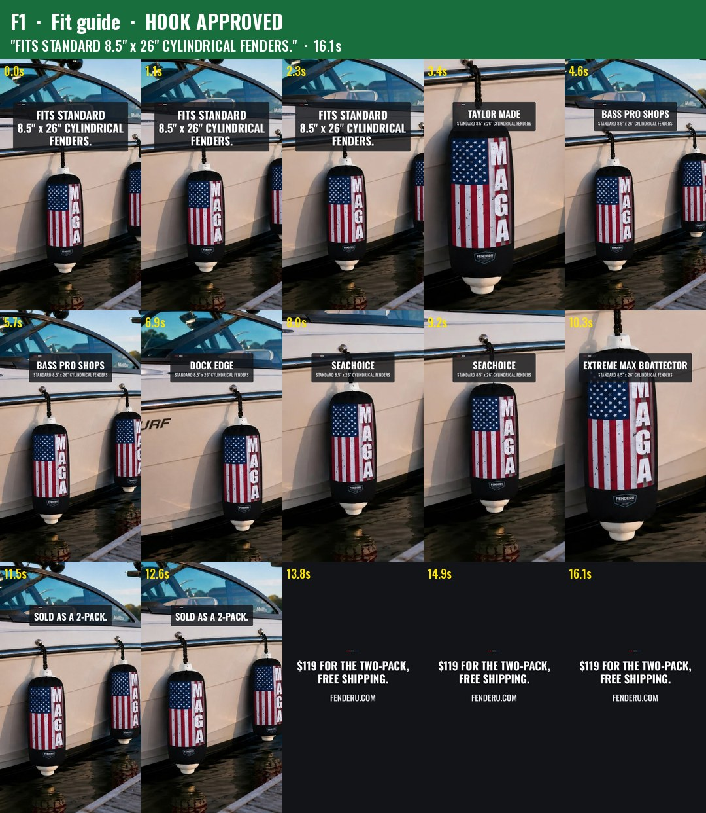
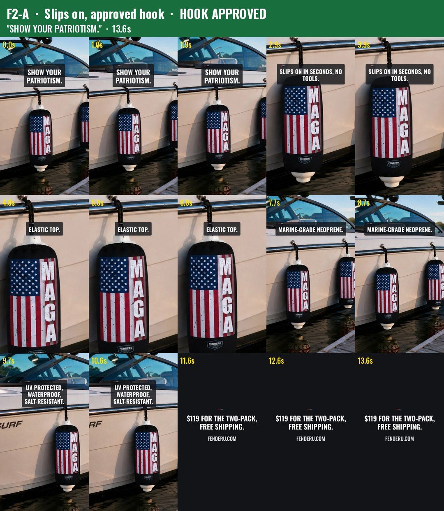
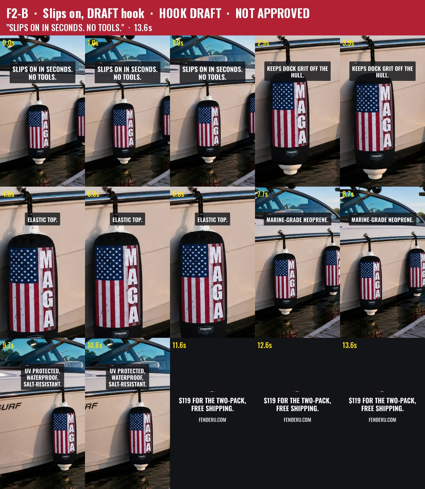
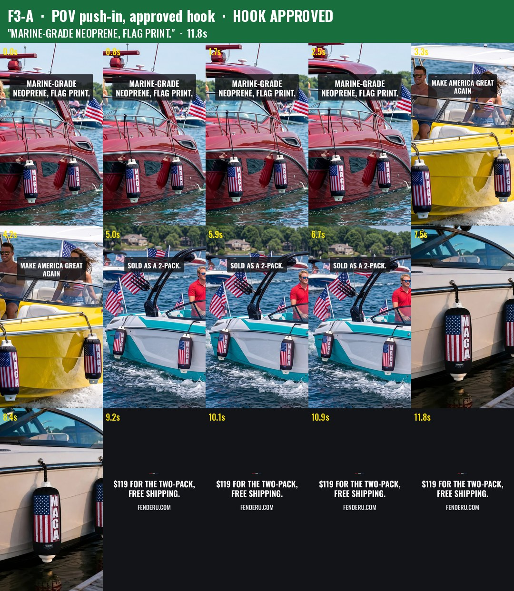
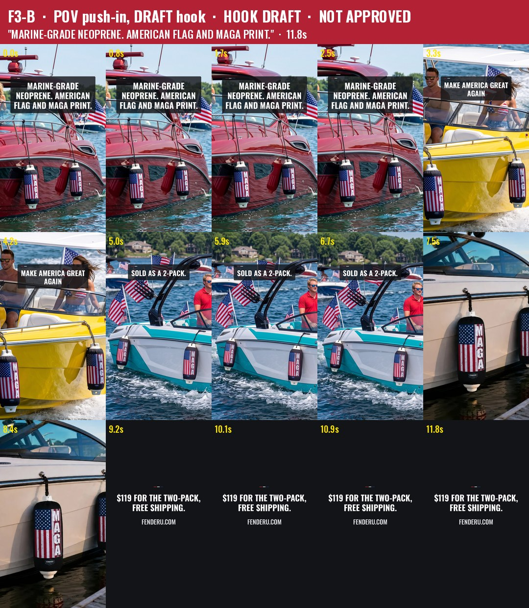
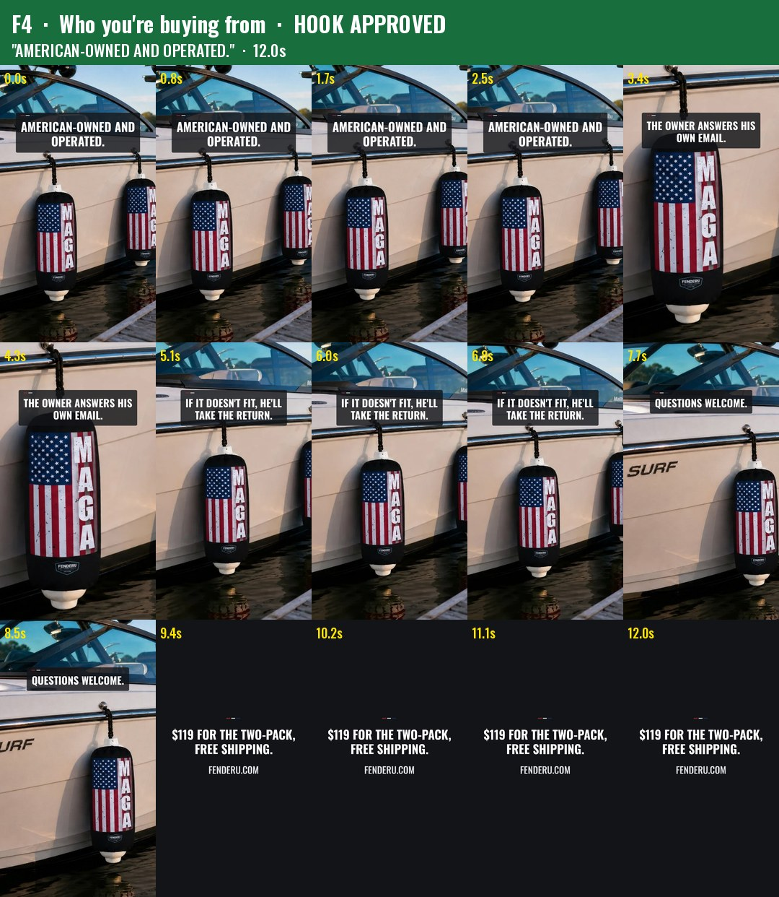
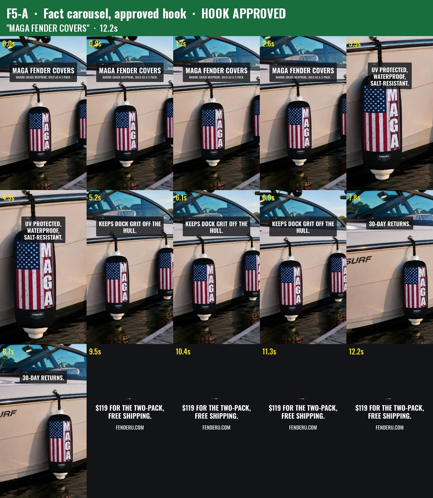
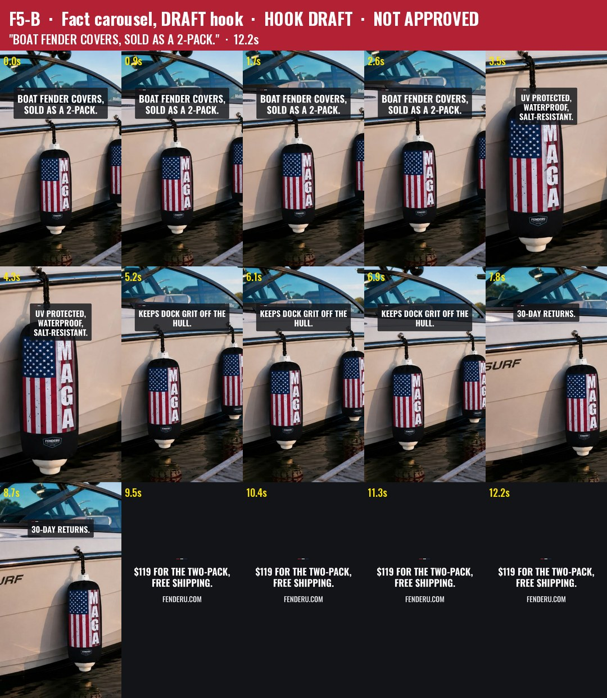

# Content Studio pack, 9 Nov 2026

**Nothing here has been posted.** Every item waits for Garrett's word per item.
Built by `marketing/content-studio/build_studio.py` (rerun: `python3 build_studio.py F1`).

## How to read this

- **One master file per video** goes to every platform: TikTok, Instagram Reels, Facebook Reel (the file carries a silent AAC track, so use UploadVideo, never uploadAReel) and Pinterest video pin. Each video also has a 1080x1350 still (`*-still-1080x1350.jpg`) for the Facebook photo rotation and Pinterest, and a 5x3 frame grid (`*-grid.jpg`).
- **Spec (checked with ffprobe):** H.264 High, 1080x1920, 30 fps, AAC 44.1 kHz silent track (max volume −91 dB), 11.8 to 16.1 s, 2.4 to 4.2 MB.
- **Cover pixels:** photos are only cropped and scaled (one Lanczos pass). There's no filter, grade or redraw. A decoded video frame against a plain scale of the source photo measures 41.7 dB PSNR, which is the difference H.264 compression alone makes.
- **First frame** of every video is a cover on a fender on a boat. Hooks stay on screen for the first 2.8 s, in the centred safe zone (text bands start 330 px from the top and end above 1,250 px, with 130 px or more clear at the sides). Hard cuts come every 1.7 to 2.8 s.
- **End card** on every video: "$119 FOR THE TWO-PACK, FREE SHIPPING." and "FENDERU.COM". Checked on all eight grids.
- **Banned-list text check:** every on-screen line and every caption below was run through the build's banned list (the pair, USPS, edge to edge, every dock/marina/parade, matched pair, port and starboard, fly/flying/flies, American-made, scarcity, shipping time, origin, payment methods, ratings). There were **0 hits.**
- **Research section F had banned lines. They were fixed here, not copied:** F1's end card "$119 the pair" became the approved price line. F3's "edge to edge" was dropped. F5's "USPS Priority Mail with tracking" slide was replaced by the price end card.
- **AI label:** F3-A and F3-B use Garrett's Runway photos (02, 03, 05). Toggle "AI-generated content" on TikTok and on Instagram/Facebook when posting those two. All the other videos use only his real Malibu photos, so they need no label.
- **Music:** none in the files. A song goes on in the app (launch-plan.md §4). Instagram through vidIQ posts without a song.
- **Hashtags:** 5 per post, from the approved pool only. The research's extra tags (#boattok and the rest) are not used because Garrett has not approved them.

## Captions (verbatim from `marketing/captions.md`; only the hashtag line is trimmed to 5 from the approved pool)

**Reel caption.** TikTok and IG get it with 5 tags; the Facebook Reel gets the bank caption whole.
> Make America Great Again — right down to the fenders.
> Marine-grade neoprene, flag print. Sold as a 2-pack.
> $119 for the two-pack, shipping included.
> fenderu.com
> #maga #boatlife #boating #americafirst #patriot

**Photo caption.** TikTok and IG get it with 5 tags; Facebook gets it whole.
> Show your patriotism.
> Marine-grade neoprene. UV protected, waterproof, salt-resistant. Fits standard 8.5" x 26" cylindrical fenders. Sold as a 2-pack.
> $119 for the two-pack, shipping included.
> fenderu.com
> #boataccessories #boatlife #boatgear #americafirst #patriot

**Group-post caption.** TikTok and IG add the 5 tags; Facebook gets it as written.
> MAGA fender covers — marine-grade neoprene, sold as a 2-pack.
> Fits standard 8.5" x 26" cylindrical fenders. $119 for the two-pack, shipping included.
> American-owned and operated.
> Questions welcome.
> fenderu.com
> #maga #boatlife #boating #americafirst #patriot

**Pinterest, every video.** Title (keywords, not a slogan): "MAGA Fender Covers, Marine-Grade Neoprene, Sold as a 2-Pack". The description is the group-post caption without hashtags. Link: https://fenderu.com/

## The videos

| Video | File | Hook on screen (first 2.8 s) | Hook status | Rest of the on-screen text (source) | Caption | Length | Photos used |
|---|---|---|---|---|---|---|---|
| **F1** Fit guide | `fenderu/F1/F1.mp4` | FITS STANDARD 8.5" x 26" CYLINDRICAL FENDERS. | **APPROVED** (captions.md, photo post) | TAYLOR MADE / BASS PRO SHOPS / DOCK EDGE / SEACHOICE / EXTREME MAX BOATTECTOR, each with "STANDARD 8.5" x 26" CYLINDRICAL FENDERS" (standing rules, approved facts). SOLD AS A 2-PACK. (captions.md) | Photo | 16.1 s | g03, g04, g01, g02 (real) |
| **F2-A** Slips on | `fenderu/F2-A/F2-A.mp4` | SHOW YOUR PATRIOTISM. | **APPROVED** (9 Oct, captions.md) | SLIPS ON IN SECONDS, NO TOOLS. / ELASTIC TOP. (approved facts). MARINE-GRADE NEOPRENE. / UV PROTECTED, WATERPROOF, SALT-RESISTANT. (captions.md) | Photo | 13.6 s | g03, g04, g01, g02 (real) |
| **F2-B** Slips on | `fenderu/F2-B/F2-B.mp4` | SLIPS ON IN SECONDS. NO TOOLS. | **DRAFT**. Built from an approved fact, but not yet approved as a hook | KEEPS DOCK GRIT OFF THE HULL. / ELASTIC TOP. (approved facts). MARINE-GRADE NEOPRENE. / UV PROTECTED, WATERPROOF, SALT-RESISTANT. (captions.md) | Photo | 13.6 s | g03, g04, g01, g02 (real) |
| **F3-A** POV push-in | `fenderu/F3-A/F3-A.mp4` | MARINE-GRADE NEOPRENE, FLAG PRINT. | **APPROVED** (captions.md, reel) | MAKE AMERICA GREAT AGAIN (9 Oct). SOLD AS A 2-PACK. (captions.md) | Reel | 11.8 s | Runway 02, 03, 05 (clean 2200) + g03. **AI label on** |
| **F3-B** POV push-in | `fenderu/F3-B/F3-B.mp4` | MARINE-GRADE NEOPRENE. AMERICAN FLAG AND MAGA PRINT. | **DRAFT**. Research line with "edge to edge" removed | same as F3-A | Reel | 11.8 s | same as F3-A. **AI label on** |
| **F4** Who you're buying from | `fenderu/F4/F4.mp4` | AMERICAN-OWNED AND OPERATED. | **APPROVED** (captions.md, group post) | THE OWNER ANSWERS HIS OWN EMAIL. / IF IT DOESN'T FIT, HE'LL TAKE THE RETURN. (approved facts). QUESTIONS WELCOME. (captions.md) | Group | 12.0 s | g01, g04, g03, g02 (real) |
| **F5-A** Fact carousel | `fenderu/F5-A/F5-A.mp4` + `F5-A-carousel-1..5.jpg` | MAGA FENDER COVERS / MARINE-GRADE NEOPRENE, SOLD AS A 2-PACK. | **APPROVED** (captions.md, group post first line) | UV PROTECTED, WATERPROOF, SALT-RESISTANT. (captions.md). KEEPS DOCK GRIT OFF THE HULL. / 30-DAY RETURNS. (approved facts) | Group | 12.2 s | g03, g04, g01, g02 (real) |
| **F5-B** Fact carousel | `fenderu/F5-B/F5-B.mp4` + `F5-B-carousel-1..5.jpg` | BOAT FENDER COVERS, SOLD AS A 2-PACK. | **DRAFT**. "Boat fender covers" is not an approved phrase (research F5) | same as F5-A | Group | 12.2 s | same as F5-A |

Photo key: g01 = `media_southern_g01-pair-portrait`, g02 = `g02-dock-square`, g03 = `g03-wake-surf-portrait`, g04 = `g04-detail-portrait` (Garrett's own photos, `marketing/src/`, the same files as fenderu.com/media/southern). Excluded on purpose: `m02`, `m03` and `m04` carry banned copy burned in ("the pair", "port and starboard", "matched pair", "made for American boats"), so they were not used.

F5 is the research's carousel. It is built two ways: the video, and five 1080x1350 slides (`-carousel-1` to `-5`) for a TikTok or Instagram photo carousel. Group posts in Facebook Groups stay **plain photos with no type** (standing rule), so the slides are not for Groups.

F4 is the research's "founder voiceover" piece. There's no voice in it: the first-person lines ("I answer my own email") would be new sayings. If Garrett ever records a voiceover, it has to read the approved lines as written.

## Frame grids

| | |
|---|---|
|  |  |
|  |  |
|  |  |
|  |  |

Red header = DRAFT hook, not approved. Green header = approved hook.

## The Outfit: not built this run

The Outfit repo (GarrettOU/Outfitter---apparel-) is not reachable from this session. Attaching it was refused by the session's permission check, and the git clone needs credentials this session does not have. Without `designs/` and `company/decisions.md` there are no approved mockups to build from, so **no Outfit video was made.** No substitute imagery was used. Next run: attach that repo to the session, and the two Outfit videos (research F1 mockup reveal, F2 Christmas store explainer) get built the same way, with the AI label on, no price and no lodge-cut number.

## Words Garrett can say

| Say | What happens |
|---|---|
| "post F1" (or F2-A, F3-A, F4, F5-A) | Goes to the Facebook Page as a reel (UploadVideo) and Pinterest as a video pin. TikTok and Instagram stay on his phone, or vidIQ once Instagram is connected |
| "approve F2-B hook" / "approve F3-B hook" / "approve F5-B hook" | The draft line becomes approved copy and the B version can be posted |
| "no F2-B" (etc.) | The B version is shelved; the A version stands |
