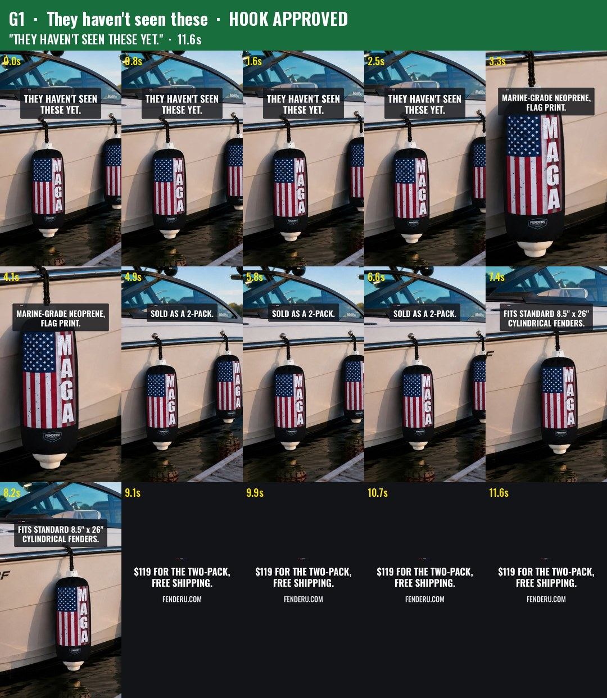
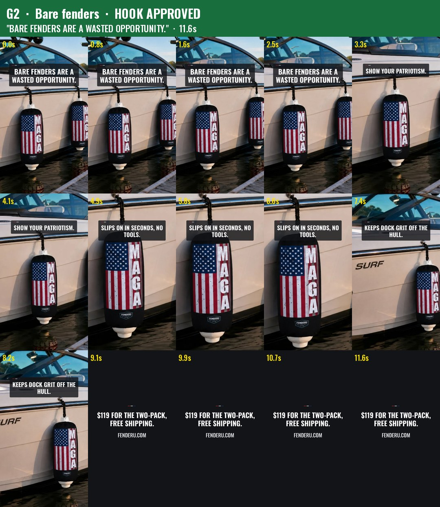
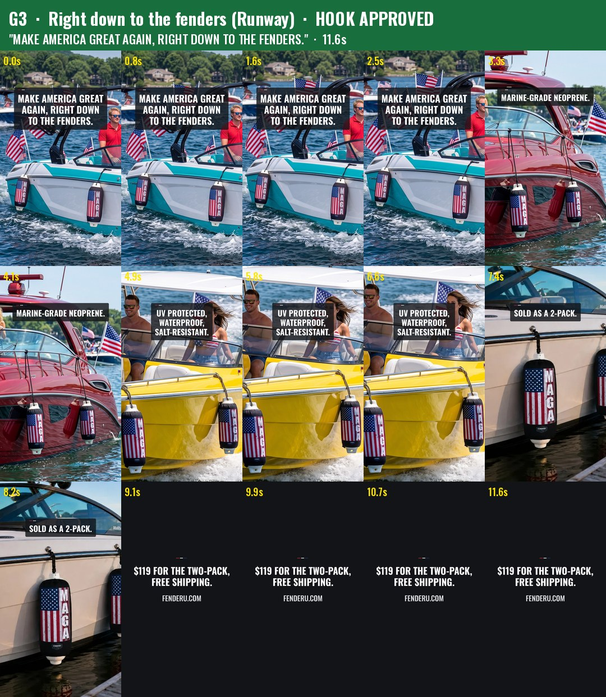
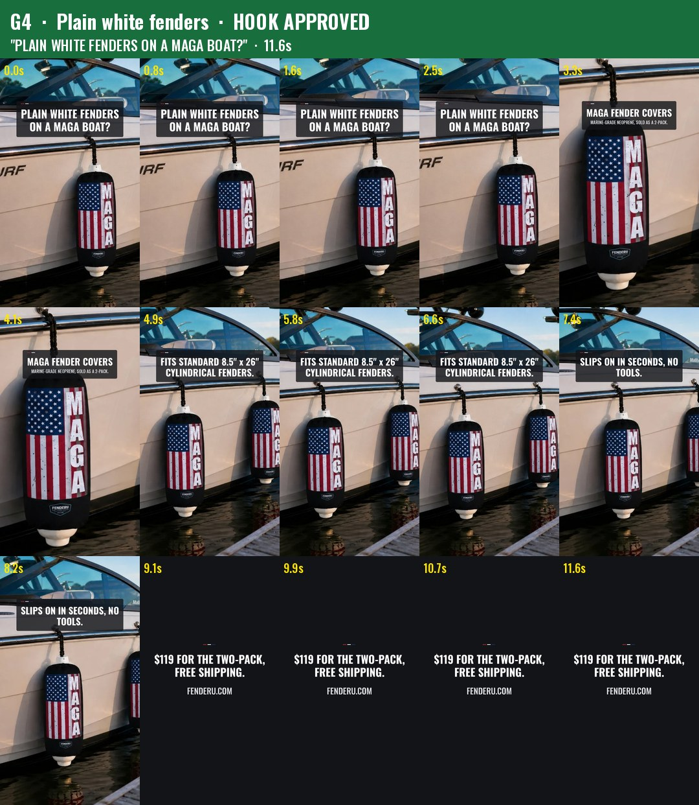
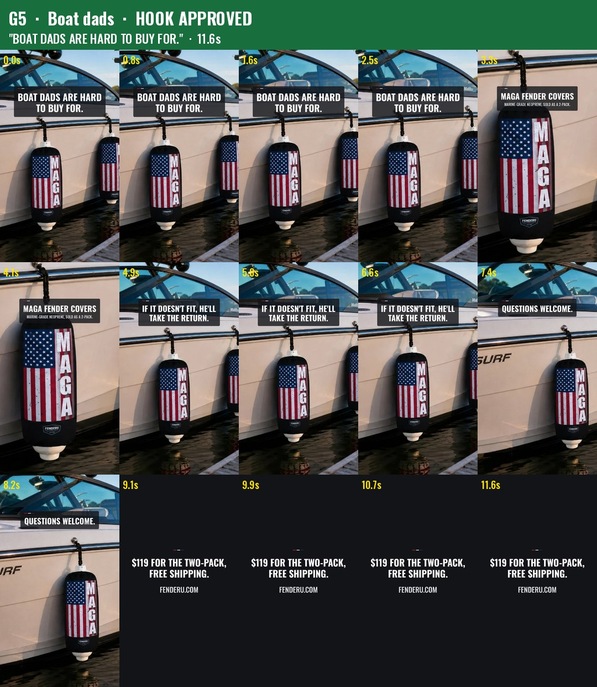

# Content Studio pack, 11 Nov 2026

> **Internal document. Never paste from it.** Copy only from the caption blocks.

**Nothing here has been posted.** Every item waits for Garrett's word per item. The 9 Nov pack (F1-F5, PR #5) is still waiting too.

Built by `marketing/content-studio/build_studio.py` (`STUDIO_PACK=2026-11-11 python3 build_studio.py`, with `--check` for text only).

## How to read this

- **One master file per video** goes to TikTok, Instagram Reels, the Facebook Reel and the Pinterest video pin. The Facebook Reel uses the UploadVideo module; the file carries a silent AAC track. Each video folder also holds `*-still-1080x1350.jpg` (for the Facebook photo rotation and Pinterest), `*-grid.jpg` (a 5x3 frame grid) and `*-frame1.jpg` (the first frame).
- **Spec (ffprobe):** H.264 High, 1080x1920, 30 fps, AAC silent track, 11.6 s each.
- **Hooks:** all five are Garrett's own approved lines, P1, P2, P3, P5 and P6 from `marketing/tiktok-instagram/launch-plan.md`. He approved them on 6 Nov ("Approve the post.", HQ.md section 3). The SI Claude Head confirmed on 9 Nov that P5 and P6 are included. **There are no DRAFT hooks in this pack.**
- **Body lines** come verbatim from `marketing/captions.md` or the standing-rules approved facts. Each one is listed below.
- **Checks:**
  - `--check` runs 32 on-screen lines and 15 caption lines through the banned list: 0 hits.
  - Measured minimum clear space at the sides: G1 111 px, G2 112, G3 111, G4 126, G5 126. All are at or above the 108 px (10%) target.
  - Text sits 330 to under 1,250 px from the top.
  - The hook shows for the first 2.8 s, with cuts every 2.0 to 2.8 s.
  - Every end card reads "$119 FOR THE TWO-PACK, FREE SHIPPING." and "FENDERU.COM". I looked at all five grids.
- **Cover pixels:** photos are only cropped and scaled (one Lanczos pass), the same pipeline as 9 Nov (41.7 dB PSNR against the source).
- **First frame** of every video is a cover on a fender on a boat.
- **AI label:** G3 uses Garrett's Runway photos 02, 03 and 05 (`runway/clean/2200`). Turn on "AI-generated content" on TikTok, Instagram and Facebook when posting it. G1, G2, G4 and G5 use only his real Malibu photos (g01 to g04).
- **Music:** none in the files. The song is added in the app, using the pairings in launch-plan.md section 3: P1 Ain't Seen Nothin' Yet (BTO); P2 Life Is a Highway (Rascal Flatts); P3 Calling Me from Miami (Blake Shelton); P5 Lose Yourself, instrumental (Eminem); P6 It Ain't Me (CCR).

## Captions

These are verbatim from `marketing/captions.md`. TikTok and Instagram get 5 hashtags from the approved pool; Facebook gets the bank caption whole.

**Reel caption**
> Make America Great Again — right down to the fenders.
> Marine-grade neoprene, flag print. Sold as a 2-pack.
> $119 for the two-pack, shipping included.
> fenderu.com
> #maga #boatlife #boating #americafirst #patriot

**Photo caption**
> Show your patriotism.
> Marine-grade neoprene. UV protected, waterproof, salt-resistant. Fits standard 8.5" x 26" cylindrical fenders. Sold as a 2-pack.
> $119 for the two-pack, shipping included.
> fenderu.com
> #boataccessories #boatlife #boatgear #americafirst #patriot

**Group-post caption**
> MAGA fender covers — marine-grade neoprene, sold as a 2-pack.
> Fits standard 8.5" x 26" cylindrical fenders. $119 for the two-pack, shipping included.
> American-owned and operated.
> Questions welcome.
> fenderu.com
> #maga #boatlife #boating #americafirst #patriot

**Pinterest, every video:** the title is the approved line as written, "MAGA fender covers — marine-grade neoprene, sold as a 2-pack." The description is the group-post caption without hashtags. The link is https://fenderu.com/

## The videos

| Video | File | Hook on screen (first 2.8 s) | Hook status | Rest of the on-screen text (source) | Caption | Song (in the app) | Photos |
|---|---|---|---|---|---|---|---|
| **G1** | `fenderu/G1/G1.mp4` | THEY HAVEN'T SEEN THESE YET. | **APPROVED** (P1, 6 Nov) | MARINE-GRADE NEOPRENE, FLAG PRINT. / SOLD AS A 2-PACK. / FITS STANDARD 8.5" x 26" CYLINDRICAL FENDERS. (captions.md) | Reel | Ain't Seen Nothin' Yet | g03, g04, g01, g02 (real) |
| **G2** | `fenderu/G2/G2.mp4` | BARE FENDERS ARE A WASTED OPPORTUNITY. | **APPROVED** (P2, 6 Nov) | SHOW YOUR PATRIOTISM. (captions.md) / SLIPS ON IN SECONDS, NO TOOLS. / KEEPS DOCK GRIT OFF THE HULL. (approved facts) | Photo | Life Is a Highway | g01, g03, g04, g02 (real) |
| **G3** | `fenderu/G3/G3.mp4` | MAKE AMERICA GREAT AGAIN, RIGHT DOWN TO THE FENDERS. | **APPROVED** (P3, 6 Nov; reel caption) | MARINE-GRADE NEOPRENE. / UV PROTECTED, WATERPROOF, SALT-RESISTANT. / SOLD AS A 2-PACK. (captions.md) | Reel | Calling Me from Miami | Runway 05, 02, 03 + g03. **AI label on** |
| **G4** | `fenderu/G4/G4.mp4` | PLAIN WHITE FENDERS ON A MAGA BOAT? | **APPROVED** (P5, 6 Nov) | MAGA FENDER COVERS / MARINE-GRADE NEOPRENE, SOLD AS A 2-PACK. / FITS STANDARD 8.5" x 26" CYLINDRICAL FENDERS. (captions.md) / SLIPS ON IN SECONDS, NO TOOLS. (approved facts) | Group | Lose Yourself (instrumental) | g02, g04, g01, g03 (real) |
| **G5** | `fenderu/G5/G5.mp4` | BOAT DADS ARE HARD TO BUY FOR. | **APPROVED** (P6, 6 Nov) | MAGA FENDER COVERS / MARINE-GRADE NEOPRENE, SOLD AS A 2-PACK. / QUESTIONS WELCOME. (captions.md) / IF IT DOESN'T FIT, HE'LL TAKE THE RETURN. (approved facts) | Photo | It Ain't Me | g01, g04, g03, g02 (real) |

## Frame grids

| | |
|---|---|
|  |  |
|  |  |
|  | |

## The Outfit

None built. The Outfit is out of the Content Studio's scope until a lodge signs (SI Claude Head, 9 Nov; standing note in STUDIO.md).

## Words Garrett can say

| Say | What happens |
|---|---|
| "post G1" (or G2, G3, G4, G5) | It goes to the Facebook Page as a reel (UploadVideo, page check first) and to Pinterest as a video pin. TikTok and Instagram stay on his phone, where he adds the song |
| "no G4" (etc.) | That video is shelved |
